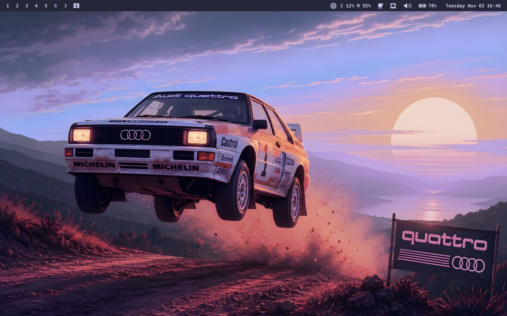

# Dotfiles



My Omarchy-inspired personal dotfiles managed with [chezmoi](https://chezmoi.io). Primarily focussed on MacOS, Linux support targets Debian/Ubuntu and Arch. Templates handle platform differences, age protects secrets, with identity recovery from Bitwarden before encrypted files are read.

chezmoi copies rendered files into `$HOME`, not symlinks. [home/](home/README.md) is the source state; repository tooling, package definitions, assets, and documentation stay outside deployment. All `README.md` files are excluded by [`.chezmoiignore`](home/.chezmoiignore).

## Getting started

Fresh Apple Silicon Mac: finish macOS Setup Assistant, connect to the internet, open Terminal, and paste:

```sh
/bin/sh -c "$(curl -fsSL https://raw.githubusercontent.com/thijserven/dotfiles/main/setup.sh)"
```

No preinstalled Git, Homebrew, chezmoi, or Xcode Command Line Tools required.

This downloads and runs [`setup.sh`](setup.sh), which installs missing Rosetta, Homebrew, and chezmoi, then applies these personal dotfiles to your home directory and changes macOS settings. Review the repository first. After macOS Setup Assistant, open Terminal as your normal administrator account; do not run with `sudo`. Requires internet and the Bitwarden identity backup described in [prerequisites](home/README.md#prerequisites). Rosetta installation automatically accepts Apple's Rosetta license and may prompt for your administrator password. Homebrew installs missing Command Line Tools before chezmoi clones the repository. Password, installation confirmations, setup values, and Bitwarden authentication remain interactive; approve any Command Line Tools dialog and wait for installation to finish before continuing. macOS privacy permissions, app sign-ins, and [finish-setup steps](home/README.md#verify-and-finish-setup) still require manual action. This is one-command bootstrap, not unattended setup.

Follow [setup and daily usage](home/README.md) for prerequisites, bootstrap commands, init prompts, verification, and troubleshooting. See [AGENTS.md](AGENTS.md) for contribution rules and safety boundaries. Do not add or generate dotfiles tests or test infrastructure; use syntax checks, linters, builds, and rendered-output inspection for validation. Tests are allowed only within `vendor/keybindings/`.

## Directory guide

- [Managed home](home/README.md) — source layout, templates, deployment, and day-to-day commands.
- [Install scripts and encryption](install/README.md) — platform-specific shell installers, Bitwarden recovery, age identities, and secret maintenance.
- [Lifecycle scripts](home/.chezmoiscripts/.README.md) — packages, app setup, desktop startup, and macOS defaults.
- [Shared templates](home/.chezmoitemplates/README.md) — VS Code settings, keybindings, and extensions for both platforms.
- [Application configuration](home/private_dot_config/README.md) — directory index for shell, Git, terminals, launcher, and desktop tools.
- [Zsh](home/private_dot_config/zsh/README.md) — startup order, environment, plugins, history, and fuzzy finding.
- [Hammerspoon](home/dot_hammerspoon/README.md) — macOS automation and login startup.
- [macOS Library](home/Library/README.md) — macOS VS Code target paths.
- [SSH](home/private_dot_ssh/README.md) — encrypted SSH configuration and keys.
- [Assets](install/assets/README.md) — wallpaper used by macOS setup.
- [Keybindings](vendor/keybindings/README.md) — native Vicinae extension, modified from [Raycast Shortcut Library](https://github.com/raycast/extensions/tree/ff678517a421538e8533030aa447420631886169/extensions/shortcut-library); built from `vendor/`, not deployed as configuration.

## Package management

[The macOS package script](install/macos/packages.sh) installs packages and casks listed in [packages.txt](install/macos/packages.txt) through Homebrew Bundle. Linux package lists and upstream installers live in [the package script](install/linux/packages.sh); Homebrew is not installed on Linux. Package scripts do not continuously reconcile installed software: review changes before rerunning them.

Personal configuration; use as inspiration rather than applying blindly to an existing machine.
